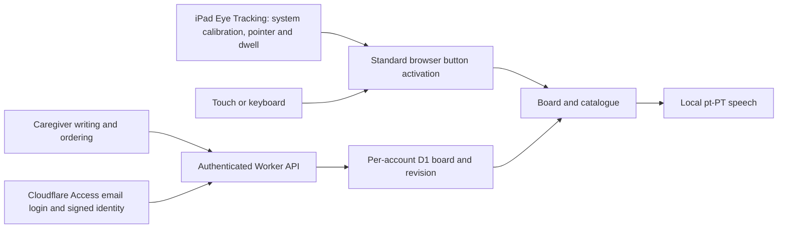

# Architecture

Experimental pt-PT communication board for iPad Safari: **four speaking targets**, standard button
activation and caregiver-only writing. It is not a medical device or an emergency communication
system.

## Runtime

TypeScript/CSS built by Vite, served by Cloudflare Workers Static Assets. The same-origin Worker
verifies Cloudflare Access human identities and serves account-scoped Cloudflare D1 preferences.
Speech runs locally; operational logging runs in the Worker.

| Module                  | Responsibility                                                                  |
| ----------------------- | ------------------------------------------------------------------------------- |
| `src/main.ts`           | Board, catalogue, replacement, caregiver form and standard click handling       |
| `src/store.ts`          | Phrase validation, defaults and immutable ordering/slot updates                 |
| `src/account-client.ts` | Access session bootstrap and revision-checked board saves                       |
| `src/access.ts`         | Signed Access JWT verification and validated D1 preferences                     |
| `src/speech.ts`         | Prefer exact pt-PT system voice, prevent queued repeats, report failures        |
| `src/worker.ts`         | Edge-protected assets, authenticated API, security headers and operational logs |

## Current storage model

Each environment has its own D1 database. `user_preferences` contains one row per verified Access
subject:

| Column           | Purpose                                                                                          |
| ---------------- | ------------------------------------------------------------------------------------------------ |
| `access_subject` | Primary key from the verified Access `sub` claim                                                 |
| `board`          | Validated JSON with `version`, ordered `phrases` and four ordered `slots` referencing phrase IDs |
| `revision`       | Nonnegative integer used to reject stale saves                                                   |

Catalogue order follows the `phrases` array; speaking-button positions follow the `slots` array. The
API reads and saves the complete board, updating its revision atomically. Email is display data, not
the storage key. New subjects receive defaults once; existing boards are preserved on login.
Wrangler maintains `d1_migrations`; SQLite/Cloudflare maintain their internal tables. Setup and
baseline-adoption checks belong in [DEPLOYMENT.md](DEPLOYMENT.md). Fresh databases and tests use
`migrations/0001_user_preferences.sql` directly; existing matching databases keep their rows when
Wrangler applies the baseline. Subsequent deployments apply only new migrations.

## Safety and privacy invariants

- Four speaking targets; catalogue navigation and replacement need no typing.
- Main targets have 24px–40px height-adaptive gaps on tablet layouts (24px on narrow screens), with
  separate navigation. A 44px bottom-left caregiver toggle opens a low, full-width panel with
  labelled sound, add-phrase and system Eye Tracking help options. Add-phrase is offered only on the
  board. Close/Escape restores toggle focus; navigation closes the panel. The idle speech status
  starts empty and clears when speech ends, without a ready-for-next-phrase message. This is
  workflow separation, not a touch-only gate or system tracking toggle.
- Speech status and action/error notices replace the caregiver helper sentence beside the footer
  toggle in a fixed 44px-high region. Messages cannot grow this region or resize speaking targets;
  long messages remain available through keyboard-focusable scrolling rather than clipping or
  overlaying controls. Short feedback is vertically centered beside the toggle below the footer
  divider; overflowing text starts at the top so it remains fully scrollable. Feedback remains
  visible when the caregiver panel is open. Its scrollbar uses a blue-grey thumb on a transparent
  track, without arrows in WebKit/Chromium. Standard CSS supports other browsers; system overlay
  scrollbars may retain platform styling.
- The header shows the question/hint. Speaking buttons show horizontally/vertically centered phrase
  text without an action subtitle; the board catalogue button has larger text. Experimental status
  stays beside the footer version; the board catalogue button adapts from 72px to 96px as viewport
  height permits.
- Replacement keeps only centered phrase text inside four tinted, dashed-border targets, with the
  selected phrase and instructions above them and descriptive accessible names. Only a successful
  save marks the updated speaking position in green.
- Standard clicks give brief color/inset feedback on buttons without moving or resizing targets,
  adding activation delays or changing speech busy guards. Reduced-motion preferences disable the
  feedback animation; pressed colors, keyboard focus and the saved-position highlight remain.
- Tablet layouts use the dynamic viewport height and shrinkable grid rows across board, catalogue,
  replacement, writing and ordering screens. Phrase typography follows the available grid height;
  the caregiver textarea cannot be manually resized past its allocated space. No overflow hiding is
  used to conceal clipped content.
- New accounts start with yes, no, bathroom and pain and the prescribed 26-template catalogue.
  Caregiver ordering and assignments survive login unchanged.
- Template IDs stay stable when the catalogue is reordered. The caregiver can move catalogue entries
  independently of the four speaking positions, and select the insertion position of a new phrase.
  Account data is validated without forcing template order on subsequent loads.
- Writing is labelled for caregivers. This is a workflow boundary, not authentication or a
  system-input lock: the website cannot disable Apple's Eye Tracking in the form.
- Persist phrases successfully before changing the in-memory board. Saves carry a revision and CSRF
  token. Failures/conflicts leave the displayed board unchanged and show recovery guidance; there is
  no offline/local fallback or silent last-writer-wins synchronization. Successful saves clear
  previous notices without a generic account-save message; action-specific feedback remains.
- Access protects each entire hostname before the Worker runs. Its login UI appears before the
  branded application home; a valid human identity opens the existing unbranded board. The
  application's entry/error screen retains the logo and a link to `/app`. An expired Access session
  redirects at the edge; fetch redirects/HTML are explicit errors rather than success-shaped
  preference responses.
- Logout clears the displayed private board and stops speech, then navigates to Access's
  `/cdn-cgi/access/logout`. Access owns session revocation and any remaining identity-provider
  sessions; the application cannot guarantee an upstream provider also signs out.
- JWT verification pins RS256, issuer and environment-specific audience and checks expiry/human
  claims. Merely supplying an email/header does not establish identity. Service Auth identities may
  retrieve build assets for smoke tests but can never retrieve or save a user's board.
- No app camera permission, face/eye measurements, model downloads or calibration reports.
- Apple owns calibration, pointer and dwell. The app does not receive gaze coordinates, assess
  tracking quality, enforce an additional dwell interval or implement a gaze repeat lock.
- The speech busy guard prevents overlapping/queued speech, not a new activation after speech
  finishes. Native repeat behavior requires physical-device acceptance.
- Backgrounding or leaving stops speech. Resize/scroll does not reset system tracking or the board.
- Semantic HTML buttons and visible keyboard focus support standard browser input.

Safari may require a touch gesture for speech. Missing pt-PT voices and speech failures are
reported; neither accent nor continuing audio authorization is guaranteed.

## Deployment boundaries

- GitHub Actions owns deployment; no Workers Builds or Cloudflare Pipelines.
- TEST and PROD are separate Workers/origins and D1 databases. Both require Access applications with
  human **Allow** policies and separate automation **Service Auth** policies. Deployments must pin
  the team domain and their distinct application audiences before merging.
- Wrangler routes every asset request through the Worker so security/no-store headers also apply to
  SPA asset fallbacks. The top-level local identity configuration remains a placeholder, never an
  authentication bypass.
- Environment-specific Access service secrets appear only in that environment's smoke step, never in
  browser assets/builds. Smoke tests validate build identity and API rejection of service
  credentials, not a human login.
- Workers Logs persist one minimal application entry per API outcome and per server failure, with
  fixed operation/category labels, HTTP status, server duration and allowlisted unexpected-error
  type. Successful assets stay quiet. No identities, phrases, credentials, raw URLs or exception
  messages are emitted by application logging. Invocation logs/tracing are disabled and platform
  query strings are redacted; Cloudflare can still attach platform metadata. This is operational
  logging, not browser telemetry or a durable security audit trail.
- PROD deploys the exact tested artifact, not a rebuilt site. Smoke checks prove asset identity, not
  physical-device acceptance. Deployment and release updates are not an atomic transaction.
- Setup: [DEPLOYMENT.md](DEPLOYMENT.md). Version/provenance: [RELEASES.md](RELEASES.md).

## Sources of truth

| Concern                              | Authority                                                             |
| ------------------------------------ | --------------------------------------------------------------------- |
| Phrases, ordering and storage schema | `src/store.ts`                                                        |
| Tracking, dwell and compatibility    | iPadOS accessibility settings and Apple's device documentation        |
| App version                          | `package.json`, mirrored by the lockfile; injected by Vite            |
| Released version                     | Immutable annotated `vX.Y.Z` tag                                      |
| Branch allocation                    | `.reader-sequence.json`, advanced by `branch:new`                     |
| Commit/PR/release policy             | `scripts/policy.ts`, hooks and CI                                     |
| Worker identity/assets               | `wrangler.jsonc`; deployment checks in `scripts/deployment-policy.ts` |
| Style                                | `.prettierrc.json`, `eslint.config.mjs`                               |
| Contributor rules                    | [CONTRIBUTING.md](CONTRIBUTING.md)                                    |

Storage schema `version: 1` is not the app version. Do not bump it for an ordinary release.

## Implementation constraints

- Preserve phrase and workflow array ordering; alphabetize static keys/imports via ESLint.
- Scripts use Node's erasable TypeScript: no runtime enums, parameter properties or decorators.
- TypeScript stays in the supported 6.0 series while typescript-eslint requires it; do not upgrade
  independently to TypeScript 7.
- The minimatch override fixes a tooling glob-amplification advisory; remove it when upstream uses a
  patched version. Lint/tests cover compatibility.
- New options should use pages of a few large targets, not crowd the board.
