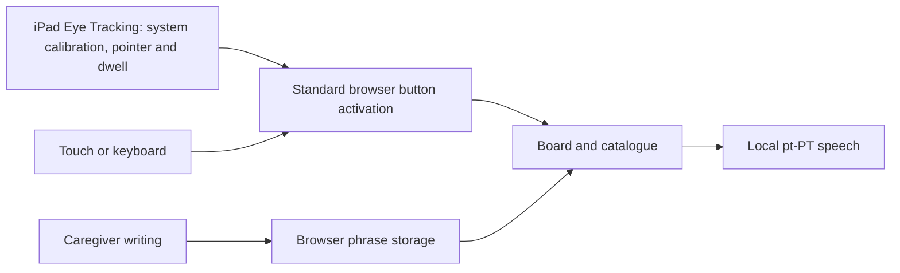

# Architecture

Experimental pt-PT communication board for iPad Safari: **four speaking targets**, standard button
activation and caregiver-only writing. It is not a medical device or an emergency communication
system.

## Runtime

Static TypeScript/CSS built by Vite, served by Cloudflare Workers Static Assets. No UI framework,
application database, external speech API, camera capture or diagnostic reporting.

| Module          | Responsibility                                                            |
| --------------- | ------------------------------------------------------------------------- |
| `src/main.ts`   | Board, catalogue, replacement, caregiver form and standard click handling |
| `src/store.ts`  | Phrase validation, immutable updates and browser storage                  |
| `src/speech.ts` | Prefer exact pt-PT system voice, prevent queued repeats, report failures  |
| `src/worker.ts` | Serve static assets unchanged                                             |

## Safety and privacy invariants

- Four speaking targets; catalogue navigation and replacement need no typing.
- Main targets have 24px–40px height-adaptive gaps on tablet layouts (24px on narrow screens), with
  separate navigation. A 44px bottom-left caregiver toggle opens a low, full-width panel with
  labelled sound, add-phrase and system Eye Tracking help options. Add-phrase is offered only on the
  board. Close/Escape restores toggle focus; navigation closes the panel. The idle speech status
  starts empty. This is workflow separation, not a touch-only gate or system tracking toggle.
- The top header shows only the question/hint. Speaking buttons show horizontally/vertically
  centered phrase text without an action subtitle; the board catalogue button has larger text.
  Experimental status stays beside the footer version; the board catalogue button adapts from 72px
  to 96px as viewport height permits.
- Tablet layouts use the dynamic viewport height and shrinkable grid rows across all four screens.
  Phrase typography follows the available grid height; the caregiver textarea cannot be manually
  resized past its allocated space. No overflow hiding is used to conceal clipped content.
- Starting slots are yes, no, bathroom and pain. Recognized old default bottom slots are upgraded on
  load (including cross-tab changes), preserving customized slots and all catalogue phrases. Save
  the upgrade before displaying it; storage failures preserve saved data and report an error.
- Template IDs stay stable when the catalogue is reordered. Saved catalogues adopt the same 26
  templates, with custom/edited text retained afterwards. Retired unchanged templates are removed;
  affected speaking slots use that position's starting phrase, never an invalid reference.
- Writing is labelled for caregivers. This is a workflow boundary, not authentication or a
  system-input lock: the website cannot disable Apple's Eye Tracking in the form.
- Persist phrases successfully before changing the in-memory board. Report/preserve corrupt storage.
- No app camera permission, face/eye measurements, model downloads or calibration reports.
- Apple owns calibration, pointer and dwell. The app does not receive gaze coordinates, assess
  tracking quality, enforce an additional dwell interval or implement a gaze repeat lock.
- The speech busy guard prevents overlapping/queued speech, not a new activation after speech
  finishes. Native repeat behavior requires physical-device acceptance.
- Backgrounding or leaving stops speech. Resize/scroll does not reset system tracking or the board.
- Semantic HTML buttons and visible keyboard focus support standard browser input.

Safari may require a touch gesture for speech. Missing pt-PT voices and speech failures are
reported; neither accent nor continuing audio authorization is guaranteed.

## Deployment boundaries

- GitHub Actions owns deployment; no Workers Builds or Cloudflare Pipelines.
- TEST and PROD are separate Workers/origins, with independent browser phrase storage.
- Optional TEST Access: browser **Allow** policy and separate automation **Service Auth** policy.
  Smoke-test service secrets appear only in TEST smoke checks, never in browser assets. PROD stays
  public. The old custom tracking header has no role; Access service headers remain authentication.
- No report routes, private R2 bindings, report secrets or scheduled cleanup.
- PROD deploys the exact tested artifact, not a rebuilt site. Smoke checks prove asset identity, not
  physical-device acceptance. Deployment and release updates are not an atomic transaction.
- Setup: [DEPLOYMENT.md](DEPLOYMENT.md). Version/provenance: [RELEASES.md](RELEASES.md).

## Sources of truth

| Concern                              | Authority                                                             |
| ------------------------------------ | --------------------------------------------------------------------- |
| Phrases, ordering and storage schema | `src/store.ts`                                                        |
| Tracking, dwell and compatibility    | iPadOS accessibility settings and Apple's device documentation        |
| App version                          | `package.json`, mirrored by the lockfile; injected by Vite            |
| Released version                     | Immutable annotated `vX.Y.Z` tag                                      |
| Branch allocation                    | `.reader-sequence.json`, advanced by `branch:new`                     |
| Commit/PR/release policy             | `scripts/policy.ts`, hooks and CI                                     |
| Worker identity/assets               | `wrangler.jsonc`; deployment checks in `scripts/deployment-policy.ts` |
| Style                                | `.prettierrc.json`, `eslint.config.mjs`                               |
| Contributor rules                    | [CONTRIBUTING.md](CONTRIBUTING.md)                                    |

Storage schema `version: 1` is not the app version. Do not bump it for an ordinary release.

## Implementation constraints

- Preserve phrase and workflow array ordering; alphabetize static keys/imports via ESLint.
- Scripts use Node's erasable TypeScript: no runtime enums, parameter properties or decorators.
- TypeScript stays in the supported 6.0 series while typescript-eslint requires it; do not upgrade
  independently to TypeScript 7.
- The minimatch override fixes a tooling glob-amplification advisory; remove it when upstream uses a
  patched version. Lint/tests cover compatibility.
- New options should use pages of a few large targets, not crowd the board.
