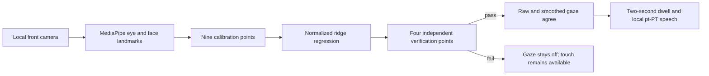

# Architecture

Experimental pt-PT communication board for iPad Safari: **four speaking targets**, touch or gaze,
and caregiver-only text entry. It is not a medical device or an emergency communication system.

## Runtime

Static TypeScript/CSS built by Vite, served by Cloudflare Workers Static Assets. No UI framework,
application database, external speech API, camera upload or calibration-report storage. Node.js is
build/deployment tooling only.

| Module             | Responsibility                                                           |
| ------------------ | ------------------------------------------------------------------------ |
| `src/main.ts`      | Board, catalogue, replacement, caregiver form and gaze lifecycle         |
| `src/store.ts`     | Phrase validation, immutable updates and browser storage                 |
| `src/speech.ts`    | Prefer exact pt-PT system voice, prevent queued repeats, report failures |
| `src/gaze.ts`      | Camera, mirrored preview, landmarks, framing and MediaPipe lifecycle     |
| `src/gaze-math.ts` | Eye/head features, mapping and per-point verification                    |
| `src/dwell.ts`     | Timed selection, target inset and repeat lock                            |
| `src/worker.ts`    | Serve static assets unchanged                                            |

## Safety and privacy invariants

- Four speaking targets; catalogue navigation and replacement need no typing.
- Adding text is caregiver-only and stops gaze.
- Persist phrases successfully before changing the in-memory board. Report/preserve corrupt storage.
- Model/WASM load from the same origin; camera images stay in the browser.
- Reject samples with no face, multiple faces, closed eyes, frozen frames or errors.
- Each verification target needs at least **12 samples**, with **90% within 12% on both screen
  axes**.
- Raw and smoothed gaze must agree with the same inset target for **2,000 ms**.
- Repeat lock needs **400 ms of valid gaze outside** the selected rectangle to release. Missing
  tracking does not unlock it; gaps over **350 ms** restart dwell progress.
- Discard calibration on viewport changes, scrolling, backgrounding, writing or stopping the camera.
  Calibration is not saved.
- Face size/position is framing guidance, not physical distance or head-pose measurement.
- Eye/iris markers and validation diagnostics are enabled locally and in TEST, and temporarily in
  PROD without headers. Landmarks do not prove accurate gaze.

Safari may require a touch gesture for speech. Missing pt-PT voices and speech failures are
reported; neither accent nor continuing audio authorization is guaranteed.

## Deployment boundaries

- GitHub Actions owns deployment; no Workers Builds or Cloudflare Pipelines.
- TEST and PROD are separate Workers/origins, with independent browser phrase storage.
- Optional TEST Access: browser **Allow** policy and separate automation **Service Auth** policy.
  Access credentials appear only in TEST smoke checks, never in browser assets. PROD stays public.
- PROD deploys the exact tested artifact, not a rebuilt site. Smoke checks prove asset identity, not
  physical-device acceptance. Deployment and release updates are not an atomic transaction.
- Setup: [DEPLOYMENT.md](DEPLOYMENT.md). Version/provenance rules: [RELEASES.md](RELEASES.md).

## Sources of truth

| Concern                              | Authority                                                             |
| ------------------------------------ | --------------------------------------------------------------------- |
| Phrases, ordering and storage schema | `src/store.ts`                                                        |
| Gaze/dwell thresholds                | `src/gaze-math.ts`, `src/dwell.ts`, `src/main.ts` and boundary tests  |
| App version                          | `package.json`, mirrored by the lockfile; injected by Vite            |
| Released version                     | Immutable annotated `vX.Y.Z` tag                                      |
| Branch allocation                    | `.reader-sequence.json`, advanced by `branch:new`                     |
| Commit/PR/release policy             | `scripts/policy.ts`, hooks and CI                                     |
| Worker identity/assets               | `wrangler.jsonc`; deployment checks in `scripts/deployment-policy.ts` |
| Style                                | `.prettierrc.json`, `eslint.config.mjs`                               |
| Contributor rules                    | [CONTRIBUTING.md](CONTRIBUTING.md)                                    |

Storage schema `version: 1` is not the app version. Do not bump it for an ordinary release.

## Implementation constraints

- Preserve phrase, calibration and workflow array ordering; alphabetize static keys/imports via
  ESLint.
- Scripts use Node's erasable TypeScript: no runtime enums, parameter properties or decorators.
- TypeScript stays in the supported 6.0 series while typescript-eslint requires it; do not upgrade
  independently to TypeScript 7.
- The minimatch override fixes a tooling glob-amplification advisory; remove it when upstream uses a
  patched version. Lint/tests cover compatibility.
- New options should use pages of a few large targets, not crowd the board.
