# Deployment setup

GitHub Actions publishes this app to two Cloudflare Workers. **Do not connect Workers Builds, Pages
or deployment hooks.** Cloudflare Pipelines is unrelated and is not used.

```mermaid
flowchart LR
  PR["Reviewed squash PR"] --> Main["main"]
  Main --> Checks["Verification and release checks"]
  Checks --> Test["Deploy TEST"]
  Test --> Release["Smoke checks, artifact and prerelease"]
  Release --> Human["Test exact tag on iPad"]
  Human --> Dispatch["Manually dispatch tested tag"]
  Dispatch --> Prod["Validate artifact and deploy PROD"]
  Prod --> Stable["Smoke checks and stable release"]
```

## 1. Check your starting point

- `main` exists on GitHub and is the default branch.
- Run `npm ci`, then `npm run verify` with the Node version in `.nvmrc`.
- Select the Cloudflare account that will own both Workers.
- Inspect existing Workers before deploying: a deployment replaces their content.
- Set up repository protection using [RELEASES.md](RELEASES.md#repository-protection).

Dashboard labels change. The names below were checked against official documentation on 2026-11-08,
not against your signed-in account. Use the linked product page if navigation differs; do not select
an unrelated product just because a menu label is missing.

## 2. Worker names and URLs

| Environment | Wrangler environment | Worker name              | Site URL                                               |
| ----------- | -------------------- | ------------------------ | ------------------------------------------------------ |
| TEST        | `test`               | `button-eye-reader-test` | `https://button-eye-reader-test.cgcnnunes.workers.dev` |
| PROD        | `production`         | `button-eye-reader-prod` | `https://button-eye-reader-prod.cgcnnunes.workers.dev` |

These are this repository's intended URLs. Copy actual URLs from Cloudflare or deployment logs;
never guess the account subdomain or reuse a deleted Worker's URL.

**Existing Workers:** find them on
[Workers & Pages](https://dash.cloudflare.com/?to=/:account/workers-and-pages). Open each Worker and
find **Settings > Domains & Routes**. Confirm its `workers.dev` URL is enabled and that no Git
repository/build integration is attached.

**New account:** configure your account's `workers.dev` subdomain on Workers & Pages. The configured
Workers can be created by their first GitHub Actions deployments; you do not need to deploy a Hello
World starter first. Before that deployment, use the name/subdomain to configure each expected URL,
then verify it against the actual URL reported by Wrangler.

If you prefer creating placeholders in the dashboard, use a Worker-only creation option without Git
integration **if one is offered**. The current
[dashboard guide](https://developers.cloudflare.com/workers/get-started/dashboard/) emphasizes
Git-connected creation; do not follow that integration for this project.

Configuration checks in `wrangler.jsonc`:

- Worker names match the table; `workers_dev: true`, `preview_urls: false`.
- Static assets come from `./dist`.
- `/` and `/index.html` run through `src/worker.ts`, which serves assets unchanged.
- No custom eye-tracking header or website camera permission is needed. Apple Eye Tracking is
  configured on the iPad independently of TEST/PROD. Optional Access authentication is unchanged.

For another account, update URLs and secrets. For another app, also change Worker names in
`scripts/deployment-policy.ts` and its tests. Separate Workers do not isolate future shared
databases or bindings automatically. Choose the final origin before saving phrases: browser storage
does not migrate between domains.

## 3. Deployment credentials

Deployment credentials are required. They are **not** the optional Access login credentials.

1. Find the account ID using Cloudflare's
   [account ID guide](https://developers.cloudflare.com/fundamentals/account/find-account-and-zone-ids/).
   Do not use a zone ID.
2. Open [user API Tokens](https://dash.cloudflare.com/profile/api-tokens/). Create separate TEST and
   PROD tokens using a custom policy:
   - Policy type: **Account**.
   - Permission: **Workers Scripts > Edit**.
   - Resource: only the selected account.
3. Copy each token directly into its GitHub environment secret; it is shown only once.

This `workers.dev` deployment does not need zone/DNS editing. Do not grant permissions for AI,
Containers or other unused products just to clear a dashboard warning. Add permissions only when
deployment logs identify a necessary missing permission.

Separate tokens help rotation/revocation, but account-scoped permissions do not restrict a token to
one Worker. Never expose PROD credentials to PR jobs or put tokens in code, URLs, logs or chat. See
[API token setup](https://developers.cloudflare.com/fundamentals/api/get-started/create-token/).

## 4. GitHub environments

In the repository's **Settings > Environments**, create exactly `test` and `production`. Use
environment secrets, not repository-wide PROD secrets.

| Setting                           | Type     | `test`                   | `production`          |
| --------------------------------- | -------- | ------------------------ | --------------------- |
| `CLOUDFLARE_ACCOUNT_ID`           | Secret   | Workers account ID       | Workers account ID    |
| `CLOUDFLARE_API_TOKEN`            | Secret   | TEST deployment token    | PROD deployment token |
| `DEPLOYMENT_URL`                  | Variable | TEST root HTTPS URL      | PROD root HTTPS URL   |
| `CLOUDFLARE_ACCESS_CLIENT_ID`     | Secret   | Only if TEST uses Access | Leave unset           |
| `CLOUDFLARE_ACCESS_CLIENT_SECRET` | Secret   | Only if TEST uses Access | Leave unset           |

`DEPLOYMENT_URL` must have no path, query or fragment. GitHub supplies `GITHUB_TOKEN`; do not create
a personal token for these workflows.

Under deployment branch/tag restrictions, select specific refs:

- `test`: allow the **main branch**.
- `production`: allow **tags matching `v*`**, not branches.
- Save, reload and confirm the rules exist; selected-ref mode without rules is not a restriction.

If available, configure required reviewers and prevent self-review for `production`. Availability
depends on GitHub plan and repository visibility. **Without that rule, there is no approval pause.**
Check your current settings rather than relying on a previously observed dashboard.

Allow the repository's Actions and authorized tag/release creation. Protect existing tags against
rewriting/deletion without blocking the release workflow. Details:
[GitHub environments](https://docs.github.com/en/actions/how-tos/deploy/configure-and-manage-deployments/manage-environments).

## 5. Optional TEST authentication

**Public TEST:** skip this section and leave both Access secrets unset. PROD stays public.
**Protected TEST:** configure an Access application covering its deployment hostname and all paths.
Protecting preview URLs alone does not protect the TEST URL.

For a new protected TEST:

1. On **Workers & Pages**, open **button-eye-reader-test**.
2. Open the **Access** tab and select **Protect this Worker behind Access**.
3. Choose **All traffic**, not **Previews only**. Here "all traffic" means traffic to this TEST
   Worker, not the app's PROD Worker.
4. Select/configure an authentication policy, then **Apply Access**.
5. Configure browser and automation policies below.

If already protected, edit its existing Access application rather than creating another. Enable Zero
Trust first if prompted. **Do not use Protect all Workers**: that would also protect PROD. Do not
configure a Tunnel for this already-hosted Worker. See
[Worker Access setup](https://developers.cloudflare.com/workers/configuration/cloudflare-access/#protect-one-worker).

| Who needs access?   | Authentication                            | Required policy when used                              |
| ------------------- | ----------------------------------------- | ------------------------------------------------------ |
| iPad/browser tester | One-time PIN or another identity provider | **Allow**, including approved users                    |
| GitHub smoke checks | Client ID + Client Secret                 | **Service Auth**, including the selected service token |

Access protection and browser login choices are optional. **Once TEST is protected, this
repository's automated smoke checks need service-token access.** Browser login cannot authenticate
those checks; Service Auth alone does not give Safari an email-code login.

### Optional browser access: email code on iPad Safari

Cloudflare offers a free Zero Trust plan. No paid Safari header tool is needed.

1. Find **Identity providers** in Zero Trust (currently **Integrations > Identity providers**). Add
   **One-time PIN**; new accounts do not necessarily have it enabled.
2. Edit the TEST Access application and enable One-time PIN as a login method.
3. Attach a separate **Allow** policy: **Include > Emails**, with approved tester addresses only.
4. Keep the existing **Service Auth** policy for automation.
5. Save, reload and confirm the login method and both policies persisted.
6. Open TEST in iPad Safari, request an email code and enter it. Sign in again when the session
   expires.

A different identity provider can replace One-time PIN with its matching Allow policy. Do not add an
everyone/Bypass rule to fix a login problem. Safari has no built-in custom-header setting; keep
service-token credentials out of extensions, bookmarks, query strings and app code.

### Optional automated access: service token

1. Find **Service Tokens** in Zero Trust (currently **Access controls > Service credentials >
   Service Tokens**).
2. Create a token, choose its expiration and copy its Client ID and Client Secret.
3. Attach a **Service Auth** policy to the TEST application: **Include > Service Token**, selecting
   that token. Keep it separate from the browser Allow policy.
4. Save both values in the GitHub `test` environment using the Access secret names in section 4.

The workflow sends `CF-Access-Client-Id` and `CF-Access-Client-Secret` only during TEST smoke
checks, including model/WASM requests. Both secrets must be set together. They are never bundled
into the app, and smoke requests do not follow redirects. PROD sends no Access credentials.

**Verify both paths:** an approved iPad browser can sign in; an unauthenticated browser is denied;
TEST smoke checks pass. To make TEST public, remove its Access protection and clear both GitHub
Access secrets together. Editing repository files does not configure Cloudflare policies or GitHub
secrets.

Official guides:
[One-time PIN](https://developers.cloudflare.com/cloudflare-one/integrations/identity-providers/one-time-pin/),
[Service tokens](https://developers.cloudflare.com/cloudflare-one/access-controls/service-credentials/service-tokens/),
[Policies](https://developers.cloudflare.com/cloudflare-one/access-controls/policies/).

## 6. Deploy and verify

1. Squash-merge a reviewed PR with green checks. The main push starts **Deploy to TEST**.
2. Wait for the whole workflow to succeed: verification, deployment, smoke checks, artifact and
   prerelease creation. A started build or a tag alone is not success.
3. On iPad, test the deployed version using [TESTING.md](TESTING.md). Record the tag/SHA from
   `release.json` before another merge replaces TEST.
4. Follow [PROD promotion](RELEASES.md#promote-to-prod) using that exact tested tag.
5. Confirm PROD's final workflow result, site footer and `release.json`. Verify sound, four phrases,
   catalogue controls and native Eye Tracking on the device.

Smoke checks verify release identity, exact HTML/marker bytes and security headers. They do not
prove physical eye-tracking accuracy or Safari speech behavior.

## Troubleshooting

Start with the failed **GitHub Actions step**, not unrelated Cloudflare dashboard console warnings.

| Problem                                      | Check/action                                                                                                                                |
| -------------------------------------------- | ------------------------------------------------------------------------------------------------------------------------------------------- |
| Unexpected Cloudflare build                  | Disconnect Workers Builds/Git integration/hooks. Only Actions should publish.                                                               |
| Authentication/permission failure            | Account ID, correct token, expiration, and the specific permission in the log.                                                              |
| Missing configuration/assets                 | Repository root, `wrangler.jsonc`, TEST build or PROD artifact download.                                                                    |
| TEST environment rejects `main`              | Allow the main branch in GitHub's `test` environment.                                                                                       |
| iPad cannot sign in                          | Enabled identity provider and browser Allow policy; retain Service Auth.                                                                    |
| Email code does not arrive                   | Approved address, spam folder, login method. Access may say it sent a code even for a denied address.                                       |
| TEST smoke checks redirect or return 401/403 | Both Access secrets, expiration and Service Auth policy. If TEST should be public, check for unexpected protection.                         |
| URL/Worker mismatch                          | Compare `DEPLOYMENT_URL`, Wrangler name and actual deployed URL. Deployment may already have changed the wrong Worker.                      |
| Model/WASM or Node error                     | Asset download/checksum logs, `.nvmrc`, and setup-node output. Do not skip checks.                                                          |
| Old site                                     | Correct URL and final workflow success; compare `release.json`, not just a build notification.                                              |
| Tag exists but release creation failed       | Fix permissions and rerun the same commit; never move/delete the tag.                                                                       |
| Artifact expired/tampered                    | Rerun TEST for the same eligible prerelease and repeat acceptance. Never rebuild silently for PROD.                                         |
| PROD changed but workflow failed             | Inspect the deployed Worker; no automatic rollback. Retry a transient failure while still prerelease; code/config fixes need a new release. |

Stable releases cannot be redeployed/downgraded by this promotion workflow. Deleting Workers does
not reset GitHub tags/releases. Emergency rollback needs authorization and a separate procedure.
