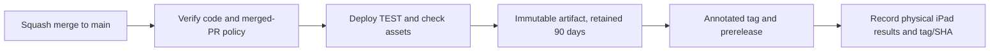

# Releases

Setup credentials/Workers using [DEPLOYMENT.md](DEPLOYMENT.md). Follow
[CONTRIBUTING.md](CONTRIBUTING.md) for branch, commit and PR rules.

## Repository protection

Configure these in GitHub; hooks and YAML do not configure server-side settings:

- `main` is the default branch.
- Squash merging only; squash subject equals the validated PR title.
- Main ruleset: PR required, `validate` from **Execute PR Validation**, up-to-date branch, linear
  history, no force pushes/deletion; approvals as appropriate.
- Allow authorized TEST tag/prerelease creation and PROD release updates.
- Protect existing release tags against rewriting/deletion.
- `test` environment permits main; `production` permits `v*` tags only.
- Required environment reviewers are optional and plan-dependent. If unavailable or unset, **PROD
  does not pause for human approval**. Inspect current settings.

## Versioning

Use only **`vX.Y.Z`**, first prerelease on TEST, then stable on PROD. No `-rc` tag or second version
on promotion.

| PR choice | From 1.2.3 | Use for                             |
| --------- | ---------- | ----------------------------------- |
| major     | 2.0.0      | Breaking contract or compatibility  |
| minor     | 1.3.0      | Backward-compatible capability      |
| patch     | 1.2.4      | Fixes, documentation or maintenance |

Run `npm run release:prepare -- patch` (or major/minor), update the changelog and select exactly one
kind in the standard PR template. The manifests must match; Vite displays this version in the
footer. The bootstrap release was v0.1.0 with minor selected.

Existing prerelease tags consume version numbers too. Wait for pending TEST release creation before
preparing the next version. Refresh branch/commit IDs and version if main advances; do not rewrite
published history without approval.

## TEST release



Every main push starts **Deploy to TEST**, but only an eligible squash commit deploys:

- One-parent commit, uniquely associated with a merged same-repository PR.
- Subject equals the PR title, optionally with GitHub's exact ` (#number)` suffix.
- Meaningful documentation and correct version/release kind.
- Successful `npm run verify` within that TEST workflow, independently of PR validation.

After smoke checks, the workflow saves the tested static artifact and creates an immutable annotated
tag/prerelease with generated notes, TEST URL and PR/run/artifact provenance. No extra version
commit or automatic PR merge is created. Existing tags never move.

TEST's URL is stable; later merges replace its content. Record the tested `release.json` tag/SHA and
device results before that happens. Never approve an old tag using a different version now on TEST.

## Promote to PROD

1. Confirm successful TEST provenance and device acceptance for the exact prerelease tag.
2. Open **Actions > Deploy to PROD > Run workflow** and select the **tag**, not main. If the
   selector only offers branches, dispatch with a tag ref using GitHub CLI:

   ```sh
   gh workflow run deploy-to-prod.yml --ref vX.Y.Z
   ```

   Replace `vX.Y.Z` with the tested tag. There is no separate tag input or approval checkbox.

3. The workflow validates the tag, TEST run and artifact. If configured, the production environment
   waits for reviewer approval; validation is repeated after the wait.
4. It downloads/hashes the original artifact, deploys it without a build, then smoke-tests PROD.
5. Only after success does the same release become stable/latest. The tag stays unchanged.

Validation requires an annotated tag on main, matching manifests, prerelease status, exact
successful TEST attempt and original unexpired artifact ID/digest. Stable releases, downgrades,
unrelated workflows, branch refs and altered artifacts are rejected. Older tags retain their older
workflow definitions.

## Runs and recovery

| Workflow              | Validation                                   | Concurrency                                       |
| --------------------- | -------------------------------------------- | ------------------------------------------------- |
| Execute PR Validation | Code plus PR policy; PR events only          | New run cancels older run for the same PR         |
| Deploy to TEST        | Code plus merged-release policy; main pushes | Serial TEST queue; no cancellation of active runs |
| Deploy to PROD        | TEST provenance/artifact, no rebuild         | Separate serial PROD queue                        |

Each deployment queue accepts up to 100 waiting runs; excess runs are canceled. Queue order is by
entry, not guaranteed merge/dispatch order. TEST does not wait for a separate validation workflow.

- Retry the same TEST commit only while its release remains prerelease. If release creation failed,
  repair permissions and rerun; do not delete/move its tag.
- Expired artifacts require a new eligible TEST attempt and repeated device acceptance.
- A failed deployment workflow can leave changed content live. There is no automatic rollback or
  transaction across Cloudflare and GitHub.
- Retry transient PROD failures while still prerelease; code/config fixes require a new release.
  Emergency rollback requires authorization and a separate procedure.
- Deleting Workers does not reset release history.

Automated checks and an explicit dispatch are not proof of physical iPad eye-tracking accuracy. See
[TESTING.md](TESTING.md) and [deployment troubleshooting](DEPLOYMENT.md#troubleshooting).
