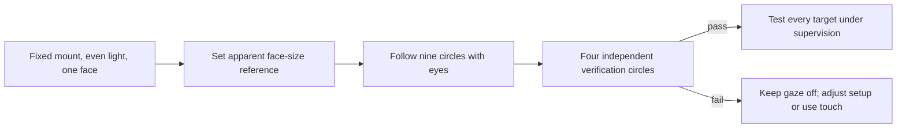

# Testing

**PC/simulated tests do not establish physical iPad gaze accuracy.** Test the intended iPad, user,
mounting position and lighting before relying on this experimental prototype.

## Commands

Use Node.js **22.22.2+** (see `.nvmrc`). `npm ci` prepares dependencies, self-hosted model/WASM and
hooks; the initial checksum-verified model download needs internet.

| Command                                      | Purpose                                                       |
| -------------------------------------------- | ------------------------------------------------------------- |
| `npm run dev`                                | Local Vite site                                               |
| `npm run assets`                             | Restore local model/WASM assets                               |
| `npm run check`                              | Strict TypeScript validation                                  |
| `npm run lint` / `npm run lint:fix`          | Type-aware lint / fixes; zero warnings                        |
| `npm run format` / `npm run format:check`    | Format / check                                                |
| `npm test` / `npm run test:watch`            | Coverage suite / interactive runner                           |
| `npm run verify`                             | Format check, lint, coverage tests, type-check and build      |
| `npm run build` / `npm run preview`          | Compile / preview static assets                               |
| `npx wrangler dev --local`                   | Local Worker runtime and static security headers; build first |
| `npx wrangler deploy --env test --dry-run`   | Validate TEST packaging without publishing                    |
| `npm run deploy`                             | Manual TEST deployment; not an eligible release               |
| `npm run branch:new` / `npm run commit:next` | Allocate feature branch / next commit scope                   |
| `npm run release:prepare -- patch`           | Prepare version; choose major/minor/patch                     |
| `npm run docs:check` / `npm run repo:check`  | Staged-doc policy / CI PR policy                              |

Required contributor workflow: [CONTRIBUTING.md](CONTRIBUTING.md).

## Automated coverage

Tests cover phrase storage/persistence, camera lifecycle, speech errors, real mapping/verification
logic, dwell/repeat locks, UI flow, diagnostics and release/deployment policy. Each included file
requires **90% statements/lines/functions and 80% branches**. Do not lower gates; the ignored HTML
report is `coverage/index.html`.

For targeted logic tests:

```sh
npm test -- tests/main.test.ts tests/gaze-math.test.ts tests/dwell.test.ts --coverage.enabled=false
```

UI tests feed synthetic features through real calibration, mapping, verification and dwell logic.
They reject static signals, missing tracking and premature/repeated selections. Simulation is
test-only: there is no shipped fake-gaze URL or calibration bypass.

## Device setup

| Device    | Setup                                                                                       | What it proves                                     |
| --------- | ------------------------------------------------------------------------------------------- | -------------------------------------------------- |
| iPad      | Updated Safari, HTTPS TEST URL, normal browsing, 100% zoom, no Split View; prefer landscape | Actual device behavior under the tested conditions |
| PC webcam | `npm run dev`, localhost, grant camera permission; choose webcam if offered                 | Useful debugging, not iPad camera/audio acceptance |

If TEST has optional Access protection, use
[browser email-code login](DEPLOYMENT.md#optional-browser-access-email-code-on-ipad-safari).
Unprotected TEST opens directly. Do not inject service-token secrets into Safari or app code. A PC's
HTTP IP address does not grant iPad camera access; trusted local HTTPS needs separate certificate
setup.

Record **app version, `release.json` tag/SHA, device/browser, orientation and results** before a
later merge replaces TEST. TEST and PROD browser storage are independent.

## Calibration and framing



- Mount at eye level; confirm the front camera, mirrored preview and both visible eyes.
- Use the **set-distance control** to save the current apparent face size. This is not a physical
  distance measurement. Confirm the setting persists after reload.
- A reference can be set when detected face width is **18%–42% of the camera image width**. Framing
  permits **78%–125% of that reference**, with separate face-centre limits. These are tolerance
  limits, not a guarantee that movement preserves accuracy.
- Keep position and distance steady; look at each circle's centre until it moves. Typical
  uninterrupted calibration/verification takes about 40 seconds.
- Each circle lasts about three seconds; sampling starts after 1.2 seconds. The progress ring is
  elapsed collection time, not proof of looking at the circle.
- Each verification point needs at least 12 samples and 90% within 12% horizontally **and**
  vertically. Static/unstable signals must not enable gaze.
- Eye diagnostics are enabled locally and in TEST, and temporarily in PROD without headers. Cyan eye
  outlines/gold iris rings show landmarks, not accurate screen gaze.
- Failure percentages report X, Y and both for each verification point. Share error text rather than
  face images; do not weaken acceptance thresholds to make a failure pass.

## Supervised acceptance checklist

Use non-sensitive phrases. Stop if selections are wrong; this is not an emergency communication
tool.

- [ ] Four speaking targets and catalogue/caregiver controls fit, including reduced Safari viewport
      height and 100-character phrases.
- [ ] Sound test and all touch phrases work; check actual pt-PT accent, volume and missing-voice
      errors.
- [ ] Catalogue has four choices/page; first/last navigation disables correctly.
- [ ] Replace a phrase, reload and confirm persistence.
- [ ] Caregiver-only additions persist; empty/duplicate/overlong input is rejected and text is
      literal.
- [ ] Permission denial/startup cancellation shows an error and preserves touch without a stuck
      camera.
- [ ] Nine-point calibration and four-point verification complete; failures keep gaze off.
- [ ] Test each target at least ten times: no speech before two seconds, in gaps or repeated while
      staring.
- [ ] Look away for 400 ms to unlock repeats; tracking loss does not unlock them.
- [ ] Closed eyes, another face, poor framing or stale frames pause selection; framing gives useful
      hints.
- [ ] Catalogue navigation, phrase selection and replacement work with gaze alone; writing stops
      gaze.
- [ ] Resize/rotate/scroll/background stops the camera and requires recalibration.
- [ ] Restart after cancellation; no leaked capture or stuck UI.
- [ ] Supervise a 15-minute session; record drift, misses, wrong selections, latency, speech
      authorization, heat and battery use.

Record intended selections, successes, wrong selections and misses for each target. Passing
automated or initial calibration checks is not clinical validation or proof of ongoing reliability.

## Testing together

The assistant cannot remotely control iPad Safari or inspect its camera. A shared desktop browser
allows UI/console interaction, not access to the iPad or its eye movements. No camera stream is sent
to the assistant. Safari remote Web Inspector normally needs a Mac and a trusted iPad connection.
Share non-sensitive error text or screenshots without faces/private phrases; do not add recording or
uploads just to debug.
